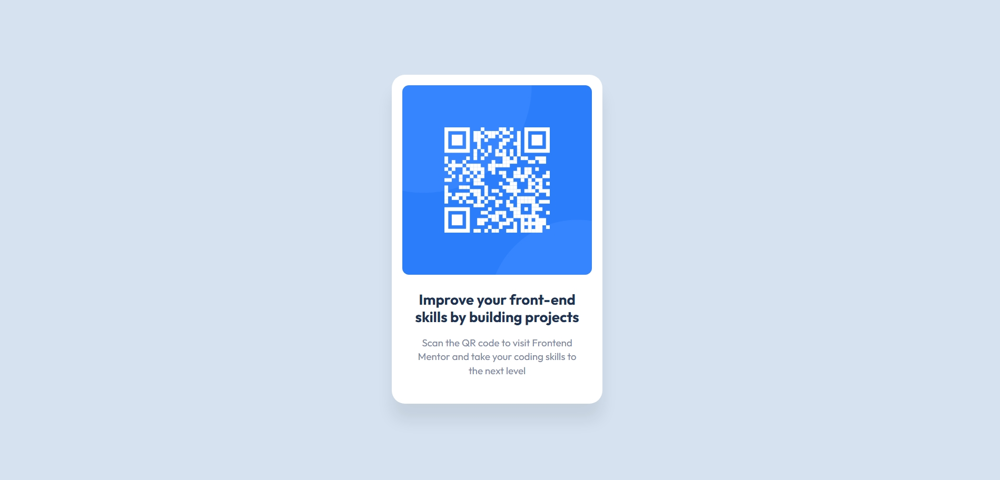

# Frontend Mentor - Componente de código QR

Esta é a minha solução para o desafio [QR code component](https://www.frontendmentor.io/challenges/qr-code-component-iux_sIO_H) do Frontend Mentor.

## Sumário

- [Visão geral](#visão-geral)
- [Meu processo](#meu-processo)
- [O que aprendi](#o-que-aprendi)
- [Autora](#autora)

## Visão geral

O desafio era construir um componente de cartão com um código QR e deixá-lo o mais parecido possível com o design original.

### Captura de tela

### Links

- Solução (Frontend Mentor): ADICIONE_AQUI_A_URL
- Site publicado: ADICIONE_AQUI_A_URL

## Meu processo

### Construído com

- HTML5 semântico
- CSS3 (Flexbox)
- Fonte Outfit (Google Fonts)

### O que aprendi

Este foi um dos meus primeiros projetos com HTML e CSS. Aprendi que:

- O HTML monta a estrutura (imagem, título e parágrafo) e o CSS cuida da aparência (cores, tamanhos e posição).
- Com `display: flex`, `justify-content: center` e `align-items: center`, consigo centralizar um elemento na tela.
- O `box-sizing: border-box` faz o padding ficar dentro da largura do elemento, deixando as medidas previsíveis.
- Com `width: 100%` na imagem, ela se ajusta ao tamanho do cartão em vez de vazar para fora.
- O `box-shadow` cria a sombra suave que faz o cartão parecer flutuar.
- Como testar o layout no modo celular usando as ferramentas de desenvolvedor do navegador (`F12`).

## Autora

- Frontend Mentor - [@KamilaPacifico](https://www.frontendmentor.io/profile/KamilaPacifico)
- GitHub - [@KamilaPacifico](https://github.com/KamilaPacifico)